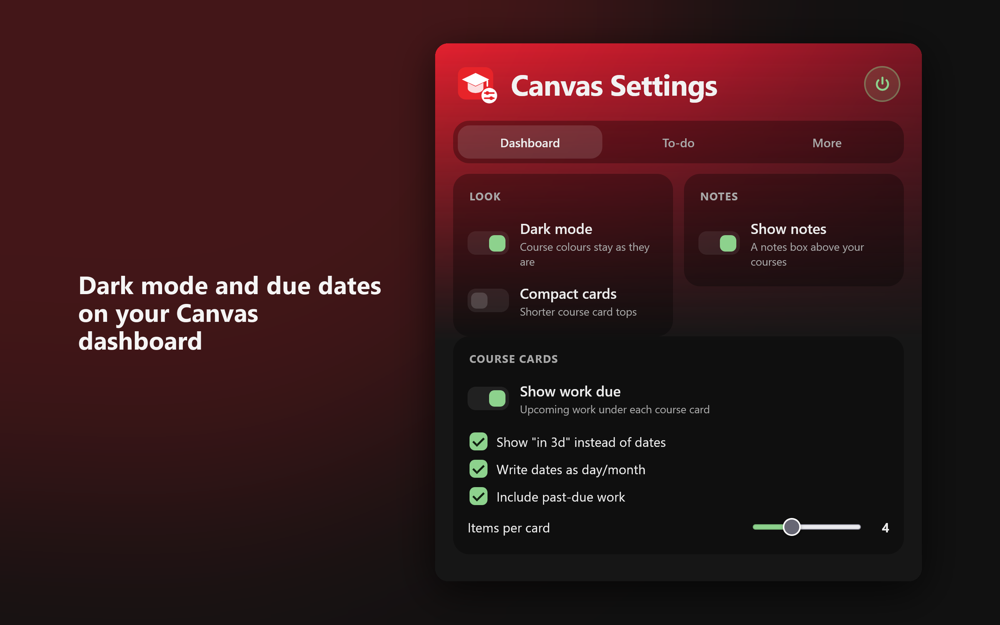
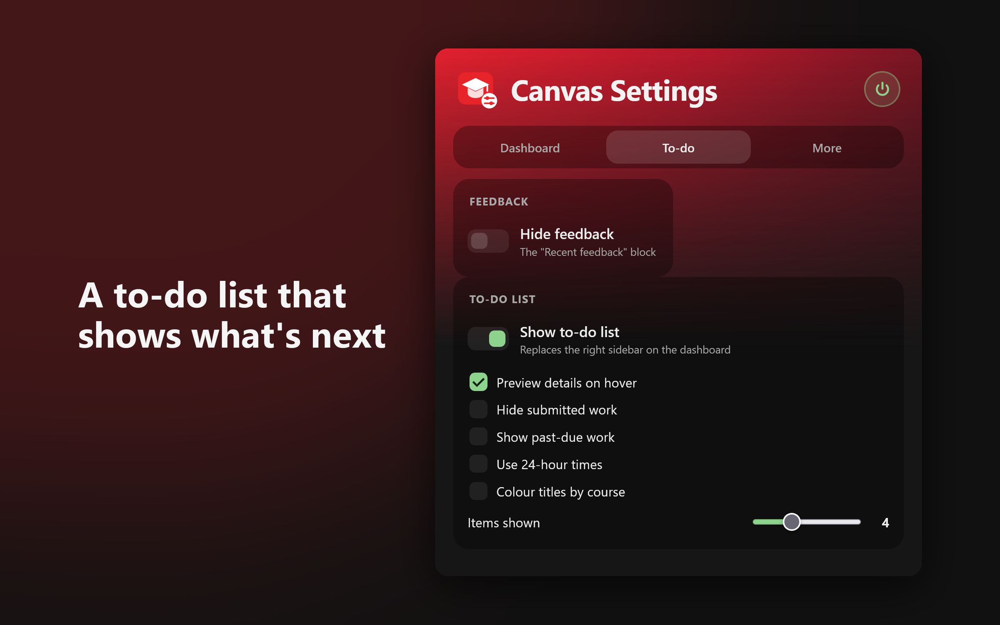
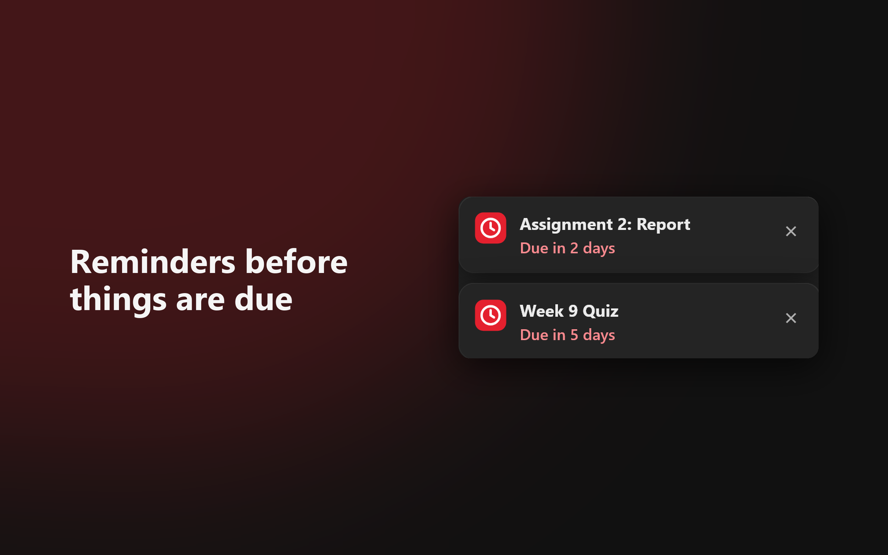

# More Settings for Canvas

A Firefox add-on that makes Canvas (the Instructure learning platform) easier to live with: a fast dark mode,
upcoming work on each course card, a better to-do list, dashboard notes, due-soon reminders on other sites and a
course file downloader.

**[Install from Firefox Add-ons](https://addons.mozilla.org/firefox/addon/more-settings-for-canvas/)** (Firefox 128 or later)

## Features

Every feature is a switch in the toolbar popup ("Canvas Settings"). The round power button turns everything off.

- **Dark mode**: only the white and light-grey parts of Canvas turn dark and the text is made readable. Course
  colours, coloured buttons and labels, photos and videos keep their exact colours.
- **Work due on course cards**: under each dashboard card, the next few assignments, quizzes and discussions, as
  "in 3d" or a date. Click a due date to cross it off.
- **To-do list**: replaces the dashboard's right sidebar. To do / Done views, announcements, a menu on each item
  (remove, cross off, add a label), your own to-dos with "+ Add", and a details preview when you hover.
- **Dashboard notes**: a notes box above your courses that saves as you type.
- **Compact cards** and **hide recent feedback**.
- **Reminders**: when something is due soon, a small card shows in the corner of other websites.
- **Download course files**: a sidebar lists a course's files by module and downloads the ones you tick to
  `Downloads/Canvas/<course>/`.

It works on `*.instructure.com` and `canvas.sydney.edu.au`. For another school's address (like
`canvas.school.edu`), type it under **More > Canvas address** and allow Firefox access when asked.

## Install

- From [Firefox Add-ons](https://addons.mozilla.org/firefox/addon/more-settings-for-canvas/), or
- From source: open `about:debugging#/runtime/this-firefox`, click **Load Temporary Add-on...** and pick `manifest.json`.

## Privacy

- Collects no data and sends nothing anywhere. There are no servers, analytics or remote code.
- The only network requests go to your own Canvas site, with your normal Canvas login, to read your planner,
  courses, course colours and (for the preview and the downloader) item details and files.
- Settings, notes, labels, your own to-dos and upcoming due dates are kept in Firefox's `storage.sync`. If you use
  Firefox Sync they're synced (encrypted) to your other Firefox computers; otherwise they stay on this one.
- Reminders on other sites are drawn inside a closed shadow root, so the site you're on can't read the titles or links.
- On Canvas pages a one-character dark mode flag (`mscv-dark`) is kept in the page's localStorage so the page
  doesn't flash white before settings load.

## Report a problem

Open an issue at https://github.com/TimWJT/more-settings-for-canvas/issues and say which Canvas address you use.

## For developers

### Files

- `manifest.json`, `settings.js` (defaults and helpers shared by everything), `background.js` (settings migration,
  the extra Canvas address, downloads)
- `content/canvas.js` + `canvas.css`: everything on Canvas pages; `content/dark.js`: the live part of dark mode
- `content/reminders.js` + `content/reminder-card.js`: reminders on other sites
- `popup.html`, `popup.css`, `popup.js`: the settings popup
- `html/downloader.html`, `js/downloader.js`, `css/downloader.css`: the course file downloader (sidebar)
- `tools/`: test scripts (not packaged). See [NOTES.md](NOTES.md).

Build the upload zip: `npx web-ext build --overwrite-dest` (`web-ext-config.mjs` leaves out docs and tools).

## Licence

All Rights Reserved. The source is public so it can be read and reviewed. See [LICENSE](LICENSE).

Not affiliated with Instructure.
